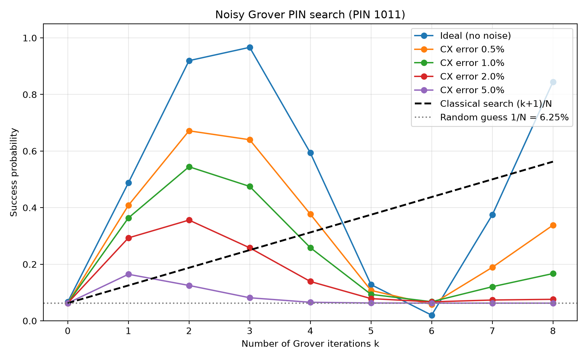
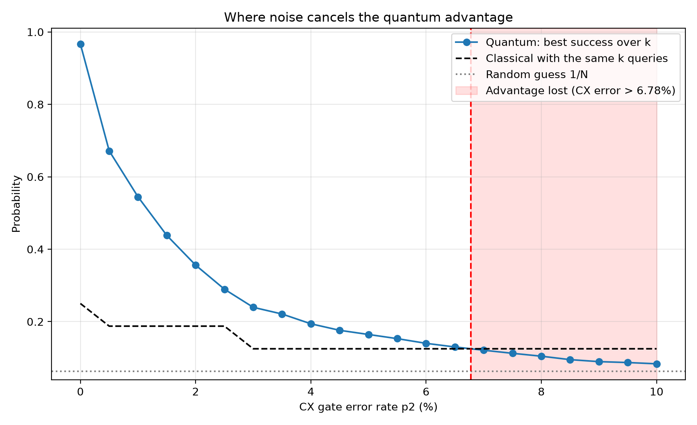
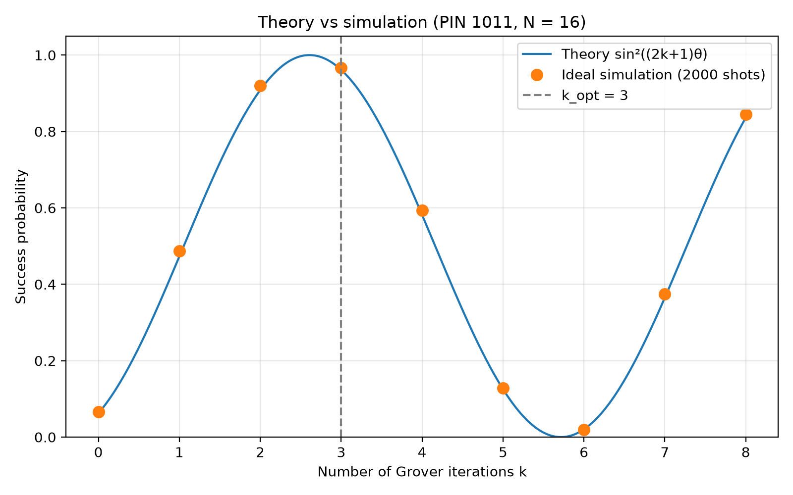
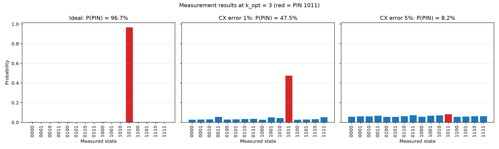
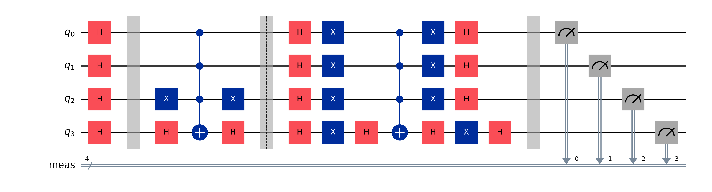

# Noisy Database Search with Grover's Algorithm

**Team G38 – Quantum Computing, 3rd IA**

## Problem statement

> **20. Noisy database search:** Run the PIN search under a noise model with realistic gate errors. Plot success probability against the number of iterations and show where noise cancels the quantum advantage. Use Grover's Algorithm.

## How to run (Windows)

```powershell
py -m venv .venv
.venv\Scripts\activate
pip install -r requirements.txt
python app.py              # web UI, opens in the browser
python run_experiment.py   # regenerates all plots + CSV in results/
```

(Tested with Python 3.12. If `py` picks a very new Python version, use `py -3.12 -m venv .venv`.)

## Project structure

```
grover.py            all quantum logic: oracle, diffuser, circuit, theory, noise model, sweep
app.py               Gradio UI (Theory / Single Run / Noise vs Iterations / How It Works)
run_experiment.py    runs the full experiment, saves plots + results.csv to results/
docs/EXPLANATION.md  plain-English walkthrough of the algorithm and the code
results/             generated plots and CSV
requirements.txt
```

## Short explanation

1. **Initialization:** H on all 4 qubits → all 16 PINs equally likely (6.25 %).
2. **Oracle:** flips the sign of |1011⟩ only (X gates + multi-controlled Z).
3. **Diffuser:** inversion about the mean, boosts the PIN amplitude.
4. Repeat oracle + diffuser k times. Theory: **P = sin²((2k+1)θ)**, θ = asin(1/√N), best k = 3 → **96.13 %**.
5. **Noise:** depolarizing errors on every gate (CX error p2, 1-qubit error p2/10) + 2 % readout error. One iteration uses 28 CX gates, so noise grows with k.

Everything is built by hand from basic gates in `grover.py` (no built-in Grover class).

## Results summary

- Ideal simulation matches theory within **1.48 %** for every k = 0..8 ✔
- Best k under noise:

| CX error | Best k | Best success | Beats classical? |
|---|---|---|---|
| 0 % | 3 | 96.65 % | yes |
| 0.5 % | 2 | 67.15 % | yes |
| 1 % | 2 | 54.45 % | yes |
| 2 % | 2 | 35.60 % | yes |
| 5 % | 1 | 16.45 % | yes (barely) |

- **Quantum advantage is lost at CX error ≈ 6.8 %.**







Full explanation, hand calculations and viva questions: [docs/EXPLANATION.md](docs/EXPLANATION.md)
