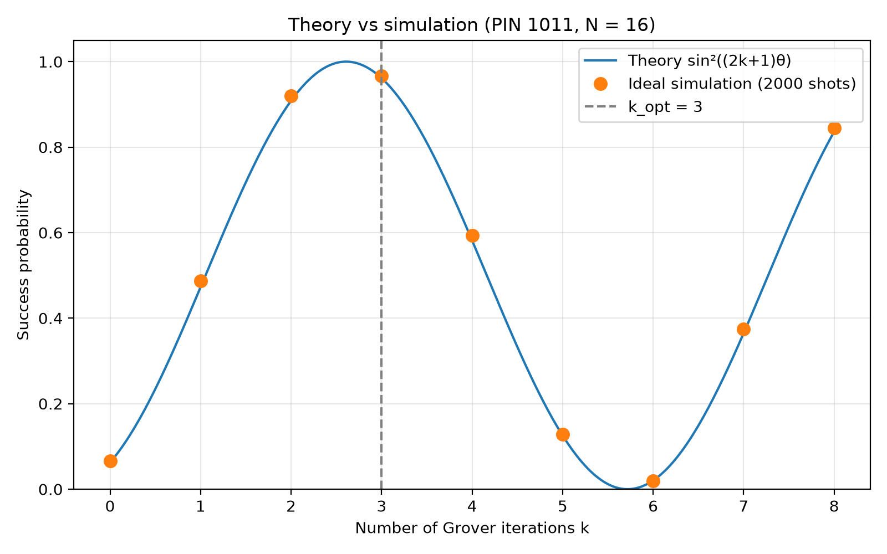
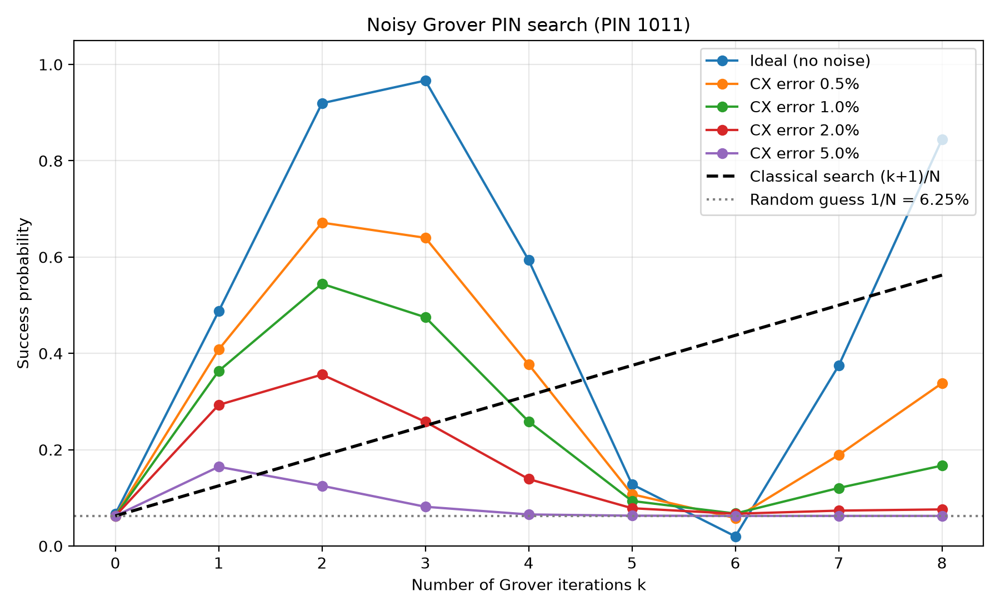
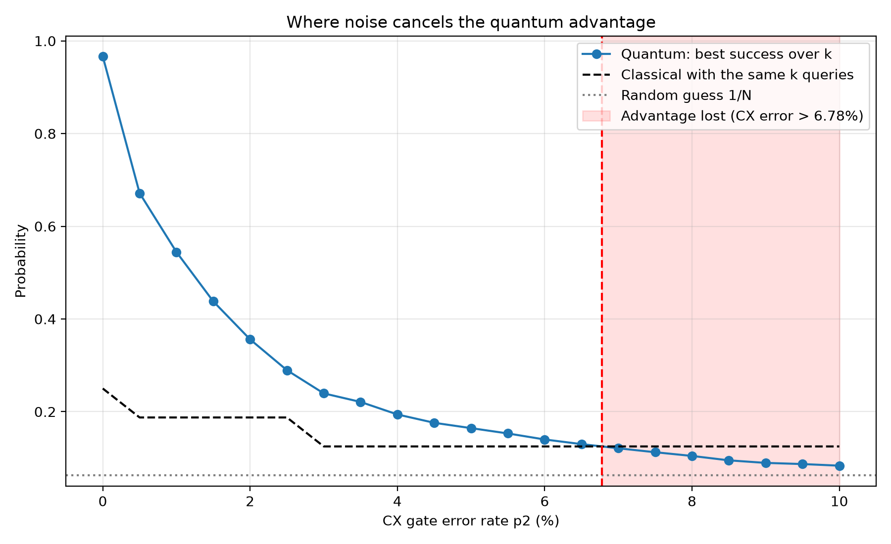
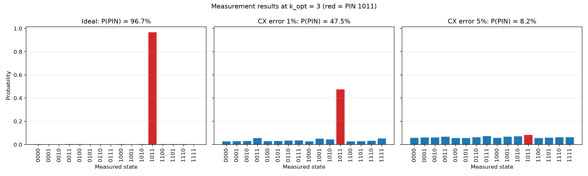
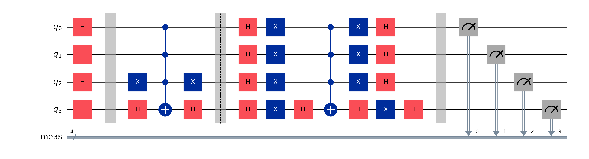

# How It Works: Noisy Database Search with Grover's Algorithm

## 1. The problem in 3 lines

- A secret 4-bit PIN (`1011`) is hidden among N = 16 possible PINs.
- Grover's algorithm finds it with far fewer "questions" than trying PINs one by one.
- Real quantum hardware is noisy, so we add realistic gate errors and find **how much noise destroys the quantum advantage**.

## 2. What is Grover's algorithm?

Grover's algorithm searches an unsorted list of N items for a marked item.

| Method | Queries needed | For N = 16 | For N = 1,000,000 |
|---|---|---|---|
| Classical (try one by one) | O(N), about N/2 on average | ~8 | ~500,000 |
| Grover (quantum) | O(√N), about (π/4)·√N | 3 | ~785 |

This is a **quadratic speedup**. It works by slowly "rotating" the quantum state towards the right answer, so the right answer becomes very likely when we measure.

## 3. Step by step with PIN = 1011 (n = 4 qubits, N = 16)

### Step 1: Initialization (Hadamard on all qubits)
H on each of the 4 qubits gives the equal superposition

|s⟩ = (1/4)(|0000⟩ + |0001⟩ + ... + |1111⟩)

Every state has amplitude 1/√16 = **0.25**, so probability 1/16 = **6.25 %**.

### Step 2: Oracle (flip the sign of the PIN)
O = I − 2|1011⟩⟨1011|. It changes amplitude of |1011⟩ from +0.25 to **−0.25**; every other state is unchanged.

How it is built: X on the qubits where the PIN bit is 0 (so |1011⟩ becomes |1111⟩), a multi-controlled Z (flips the sign of |1111⟩ only), then the same X gates again to undo.

*Bit order:* Qiskit is little-endian (qubit 0 is the **rightmost** bit). For "1011" the only 0 bit is the second from the left, which is **qubit 2**, so one X gate goes on qubit 2.

### Step 3: Diffuser (inversion about the mean)
D = 2|s⟩⟨s| − I. Every amplitude a becomes **2·mean − a**.
Built as: H on all, X on all, multi-controlled Z, X on all, H on all.

### Hand calculation of iteration 1

| | PIN amplitude | Each of the other 15 |
|---|---|---|
| After H | 0.25 | 0.25 |
| After oracle | −0.25 | 0.25 |
| Mean | (15 × 0.25 − 0.25)/16 = **0.21875** | |
| After diffuser (2·mean − a) | 0.4375 + 0.25 = **0.6875** | 0.4375 − 0.25 = **0.1875** |

P(PIN) = 0.6875² = **47.27 %** (check: 0.4727 + 15 × 0.1875² = 1 ✔).
So after just one iteration the PIN went from 6.25 % to 47.27 %.

### The geometric picture: rotation by 2θ
Write |s⟩ = cos θ |not PIN⟩ + sin θ |PIN⟩ with **sin θ = 1/√N = 0.25 → θ = 14.48°**.
The oracle and diffuser are two reflections; two reflections make a **rotation by 2θ** towards |PIN⟩. After k iterations the angle is (2k + 1)θ, so

**P(success after k iterations) = sin²((2k + 1)θ)**

| k | 0 | 1 | 2 | **3** | 4 | 5 | 6 | 7 | 8 |
|---|---|---|---|---|---|---|---|---|---|
| Theory | 6.25 % | 47.27 % | 90.84 % | **96.13 %** | 58.17 % | 12.55 % | 2.04 % | 36.49 % | 83.61 % |

### Why k = 3?
We want (2k + 1)θ ≈ 90°, so k ≈ π/(4θ) − 1/2. The code uses k_opt = ⌊π / 4θ⌋ = ⌊3.11⌋ = **3**.

### Why 96 % and not 100 %?
The angle moves in steps of 2θ = 28.96°. After 3 steps it is 7θ = 101.3°, slightly past 90°, so sin²(101.3°) = 0.9613. It cannot land exactly on 90° because k must be a whole number.

### Over-rotation
If we keep going past k = 3 we rotate **past** the PIN and the probability falls again (k = 6 gives only 2 %). It is periodic, so it rises again at k = 8 (83.6 %). More iterations is NOT always better.

## 4. The noise model

Real qubits make mistakes. We use the standard **depolarizing** model: with probability p, a gate's qubits are replaced by a completely random state.

| Error | Where | Strength |
|---|---|---|
| Depolarizing (1-qubit) | `sx`, `x` gates | p2 / 10 |
| Depolarizing (2-qubit) | `cx` gates | p2 (the slider / sweep value) |
| Readout error | every measurement | 2 % bit-flip |

**Why CX gates dominate:** the multi-controlled Z gates are broken down into basic gates. One Grover iteration (oracle + diffuser) needs **28 CX gates** (circuit depth 57). CX gates are ~10× more error-prone than 1-qubit gates, so they cause almost all the damage. Every extra iteration adds 28 more noisy CX gates.

**Simple formula:** let λ ≈ (1 − p2)²⁸ be the chance an iteration has no error. Then

**P_noisy(k) ≈ λᵏ · P_ideal(k) + (1 − λᵏ) / N**

i.e. "the part that survived works perfectly, the rest is a random guess".
Example: p2 = 1 % → λ ≈ 0.755. For k = 2: 0.755² × 0.908 + (1 − 0.57)/16 ≈ **54 %**, and the simulation gives **54.45 %**.

So noise creates a **trade-off**: more iterations rotate closer to the PIN, but each one adds noise. With noise, the best k becomes **smaller**.

## 5. WHERE IS THE CODE

| Algorithm step | File: function | Line |
|---|---|---|
| Multi-controlled Z helper | `grover.py: mcz()` | 26 |
| Step 1 – Initialization (H on all) | `grover.py: initialize()` | 40 |
| Step 2 – Oracle (flip PIN sign) | `grover.py: oracle()` | 53 |
| Step 3 – Diffuser (inversion about mean) | `grover.py: diffuser()` | 77 |
| Full circuit (init + k × (oracle + diffuser) + measure) | `grover.py: build_grover_circuit()` | 99 |
| Theory formula sin²((2k+1)θ) | `grover.py: theory_success()` | 116 |
| Optimal k = ⌊π/4θ⌋ | `grover.py: optimal_iterations()` | 127 |
| Classical baseline (k+1)/N | `grover.py: classical_success()` | 134 |
| Noise model | `grover.py: make_noise_model()` | 146 |
| Transpile + simulate | `grover.py: run_circuit()` | 167 |
| Success vs iterations sweep | `grover.py: sweep()` | 183 |
| Where advantage is lost (crossover) | `grover.py: find_advantage_loss()` | 192 |
| CX count per iteration | `grover.py: gate_counts()` | 224 |
| Web UI | `app.py` | – |
| Plots + CSV for report | `run_experiment.py` | – |

## 6. Results (from `python run_experiment.py`)

**Theory vs ideal simulation (2000 shots):** maximum difference **1.48 %** (all k within 3 %) → **theory matches simulation ✔**. The small differences are just shot noise (≈ ±1 % for 2000 shots).

**Best k at each noise level** (PIN 1011):

| CX error | Best k | Best success | Beats classical? |
|---|---|---|---|
| 0 % (ideal) | 3 | 96.65 % | yes |
| 0.5 % | 2 | 67.15 % | yes |
| 1 % | 2 | 54.45 % | yes |
| 2 % | 2 | 35.60 % | yes |
| 5 % | 1 | 16.45 % | yes, barely (classical: 12.5 %) |

**Main answer:** the quantum advantage is **lost at a CX error of ≈ 6.8 %** (6.78 % by linear interpolation). Above that, no number of Grover iterations beats a classical attacker with the same number of queries.

Circuit for k = 1:

**What we learn:**
1. Without noise, simulation matches the sin²((2k+1)θ) formula.
2. Noise flattens the curve towards the random-guess line 1/N = 6.25 %.
3. The optimal k drops from 3 → 2 → 1 as noise grows.
4. At about 6.8 % CX error, Grover is no better than classical search.

## 7. Likely viva questions

1. **Why does Grover give only a quadratic speedup, not exponential?**
   Each iteration rotates by only 2θ ≈ 2/√N, so about (π/4)√N iterations are needed. It is proven that no quantum algorithm can do unstructured search faster than O(√N).
2. **What does the oracle actually do?**
   It flips the sign (phase) of the PIN state only. The probability does not change yet; the diffuser turns this sign difference into a larger amplitude.
3. **Why do we need the diffuser?**
   It reflects all amplitudes about the mean. The PIN (negative, below the mean) is pushed far above the mean, so its probability increases.
4. **Why reversed(pin) in the oracle?**
   Qiskit is little-endian: qubit 0 is the rightmost bit of the result. Reversing makes the measured string equal to the PIN.
5. **Why is the multi-controlled Z made with H + MCX + H?**
   Because Z = H X H. Putting H around the target of a multi-controlled X turns it into a multi-controlled Z.
6. **Why 96.13 % and not 100 % at k = 3?**
   The rotation step is 28.96°; 3 steps reach 101.3°, a bit past 90°. sin²(101.3°) = 0.9613.
7. **What happens with too many iterations?**
   Over-rotation: the state rotates past the PIN and success drops (2 % at k = 6).
8. **Why does noise hurt more at large k?**
   Each iteration adds 28 CX gates, each with error probability p2. The surviving fraction λᵏ shrinks exponentially with k.
9. **What is depolarizing noise?**
   With probability p the qubit state is replaced by a completely random (maximally mixed) state; otherwise the gate works perfectly.
10. **How did you decide where the advantage is lost?**
    For each CX error we compare quantum success with a classical attacker using the same number of queries, (k + 1)/N, for every k ≥ 1. The advantage is lost when no k gives quantum > classical. Linear interpolation between 6.5 % and 7 % gives ≈ 6.8 %.
